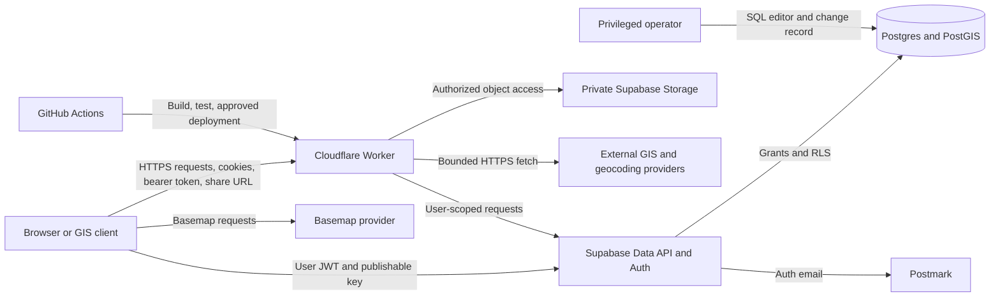

# MVP threat model

Status: design baseline, 2026-10-20. Review this model when a trust boundary,
data flow, or deployment configuration changes and before a real incident pilot.
It describes the intended MVP and distinguishes shipped controls from planned
ones. A listed threat is a risk to test, not a claim that the current code is
vulnerable. The [PRD](prd.md) defines scope, the [architecture](architecture.md)
defines the authorization contract, and [security](security.md) records the
repository's operational security baseline.

## Scope and assumptions

The system serves several organizations. A person may belong to several, but
each map and layer has one owner organization. Admins manage membership and
content; editors change content; viewers read internal content; anonymous
visitors read public or capability-shared content. External GIS feeds are
read-only. Public and unlisted resources may be copied after disclosure, so
visibility changes prevent future reads but cannot recall downloaded copies.

The current code is an Astro/Cloudflare Worker authentication shell and a
Supabase organization/membership read kernel with a private, operator-run
bootstrap. Map, layer, and association tables now have member-scoped RLS,
editor/admin writes, same-organization constraints, and negative SQL tests.
Feature geometry, invitations, photos, exports, GIS tokens, and external feed
adapters remain planned. NetEOC Dev is a development/preview project; no
production Worker is deployed. The MVP is for operational geographic data,
including potentially sensitive locations and photos. It does not intentionally
collect patient or injury records. A real pilot needs its own data handling,
provider, retention, and incident-response decisions.

The model assumes the hosting providers' infrastructure works as documented; it
focuses on NetEOC configuration, application code, SQL, and operator actions. It
does not treat a user's compromised device or a provider-wide compromise as
fully preventable by the application. Those events still require session/token
revocation, audit evidence, and recovery procedures.

## Assets and security objectives

| Asset                                                      | Required property                                                                                                                                                      |
| ---------------------------------------------------------- | ---------------------------------------------------------------------------------------------------------------------------------------------------------------------- |
| Internal maps, layers, features, notes, and geometry       | Only current members of the owner organization, or specifically scoped GIS credentials, may read them. Authorized edits must preserve provenance and revision history. |
| Unlisted share UUIDs and GIS bearer tokens                 | Holders receive only the intended read scope; values are rotatable/revocable and absent from logs, referrers, analytics, and unrelated URLs.                           |
| Memberships, invitations, platform roles, and audit events | Changes are authenticated, authorized, attributable, and resistant to replay or self-promotion.                                                                        |
| Photos and metadata                                        | The media and its location metadata follow the layer's access rules; direct Storage URLs and bucket listing cannot bypass them.                                        |
| Auth sessions, SMTP credentials, and service secrets       | Credentials stay in their intended trust zone and can be revoked after exposure. The Worker never has a Supabase service-role key.                                     |
| Operational status, timestamps, and backups                | Users can distinguish current, stale, unsaved, and unavailable information; authorized staff can restore database and objects.                                         |

Confidentiality and tenant isolation matter, but a wrong or stale road closure
or resource location can also cause operational harm. Availability and integrity
therefore receive the same release attention as unauthorized disclosure.

## Actors, entry points, and trust boundaries

Potential adversaries include an anonymous internet client, a member of a
different organization, a malicious or compromised member within the owner
organization, a holder of a leaked share link or GIS token, a malicious external
feed or uploaded file, and an operator or CI credential used outside its
intended scope. Normal third-party feeds may also be inaccurate or unavailable
without being malicious.

| Boundary                                  | Where trust must be established                                                                                                                                                                         |
| ----------------------------------------- | ------------------------------------------------------------------------------------------------------------------------------------------------------------------------------------------------------- |
| Client to Worker or Data API              | Treat IDs, organization IDs, geometry, URLs, files, headers, cookies, and JWT claims as attacker-controlled. Verify identity; use current membership rows and role checks for each operation.           |
| Public/unlisted/internal read to response | Recheck the map **and each layer** for pages, lists, metadata, exports, KML child requests, attachment reads, and conditional responses. No shared cache for internal or unlisted data.                 |
| App role to database privilege            | Postgres grants and RLS are independent. Exposed tables, views, and functions need explicit grants, policies, and negative tests. Privileged helpers live in private schemas with restricted execution. |
| Worker to provider or Storage             | A feed URL or object path does not authorize the request. Validate destinations and redirects; recheck attachment access against current layer visibility.                                              |
| Operator/CI to hosted environment         | Separate local, preview, and production credentials. Keep privileged SQL and deployment credentials outside browser and ordinary Worker request paths.                                                  |

## Prioritized threats and required controls

Priority is **inherent risk before the planned control is verified**, not a
severity rating for an observed bug. High risks block a real incident pilot
until their specified evidence passes. Medium risks need an explicit owner and
test or a documented, expiring exception under the PRD's release criteria.

| ID / priority                                       | Abuse path and consequence                                                                                                                                                    | Required control and evidence                                                                                                                                                                                                                                                                                                              | Current state                                                                                                                                                                |
| --------------------------------------------------- | ----------------------------------------------------------------------------------------------------------------------------------------------------------------------------- | ------------------------------------------------------------------------------------------------------------------------------------------------------------------------------------------------------------------------------------------------------------------------------------------------------------------------------------------ | ---------------------------------------------------------------------------------------------------------------------------------------------------------------------------- |
| T01 High: cross-tenant read or write                | An authenticated member changes an organization, layer, feature, or association ID and reads or edits another tenant's data.                                                  | Database foreign keys bind owner organization across associations; least-privilege grants and RLS check current membership and role on every exposed table. Direct SQL and API tests cover same-role, different-tenant denials and forbidden writes.                                                                                       | Organization/membership and map/layer/association RLS tests exist; feature tables and API paths do not.                                                                      |
| T02 High: visibility and cache bypass               | A public map, list, sitemap, export, ETag response, or KML child reveals an internal layer's data or even its name/count; cached data survives a visibility change.           | One read authorization contract resolves map and each layer for every path. Public discovery includes only public resources; unlisted URLs never enumerate. Internal/unlisted responses are private, no-store; test every audience, path, visibility transition, and 304 case.                                                             | Map/layer tables are member-only; visibility fields and public/sharing read paths do not exist.                                                                              |
| T03 High: capability or GIS token misuse            | A copied share UUID or bearer token is logged, sent to a third party, reused after revocation, or gains newly attached layers.                                                | Separate rotatable share UUIDs; no capability in referrers/analytics/logs. Store token digests, show plaintext once, send internal tokens in headers, snapshot layer scopes, and recheck issuer membership, association, expiry, and revocation on **each** request. Test leakage, rotation, scope expansion, and replay after revocation. | Planned; no sharing or GIS token implementation.                                                                                                                             |
| T04 High: account or role takeover                  | OTP guessing, session theft, stale role claims, invitation replay, or a role update promotes a user or preserves access after removal.                                        | Invitation-only, exact email match, single use and expiry; same-origin write checks, secure cookies, rate limits, verified claims, current membership lookup, last-admin protection, and audit. Test unknown users, replay, revoked invitations, cross-origin POSTs, role changes, and session behavior after offboarding.                 | Auth shell has code-only sign-in, limits, cookie settings, claim checks, and an origin-denial test; invitation/session lifecycle and membership mutations remain unfinished. |
| T05 High: privileged database escape                | An exposed `SECURITY DEFINER` function, default `EXECUTE` grant, view owner privilege, or service key bypasses RLS and allows cross-tenant access.                            | Keep privileged functions in an unexposed schema with fixed search path, minimal grants, explicit authorization, and audits; use invoker views. No service-role key in Worker/browser. Test `anon` and `authenticated` denial of private functions and run database advisors.                                                              | Operator bootstrap and private audit schema have direct deny tests; every future function/view needs review.                                                                 |
| T06 High: attachment disclosure or malicious upload | A guessed object path or long-lived signed URL bypasses a visibility change; an image leaks EXIF location or carries active content.                                          | Private bucket; authorize reads using current layer access; limit signed-URL lifetime and document its residual access window. Check decoded type, dimensions, size, and metadata; strip EXIF; deny direct object read and listing in tests.                                                                                               | Planned; no attachment pipeline.                                                                                                                                             |
| T07 High: server-side request forgery               | An editor supplies a KML, GeoJSON, ArcGIS, or document URL that redirects or resolves to private infrastructure or leaks Worker credentials.                                  | Controlled HTTPS fetcher with allowlisted ports/hosts where feasible, public DNS/IP checks on every hop, redirect and rebinding defense, no credential forwarding, and time/byte limits. Test private IPv4/IPv6, metadata, encoded addresses, redirects, and DNS changes.                                                                  | Planned; no external fetcher.                                                                                                                                                |
| T08 High: false or stale operational picture        | Malicious feed properties, failed refreshes, concurrent edits, or a failed save appear as current, authoritative information.                                                 | Validate geometry and content; show source, last success, staleness, and partial data. Use optimistic revisions and explicit conflict/unsaved states; keep audit trail and recovery path. Test failed provider, stale snapshot, edit conflict, and failed save in both map and list views.                                                 | Planned; current app has no GIS features or feed renderer.                                                                                                                   |
| T09 High: resource exhaustion                       | Repeated broad viewport queries, export/KML refreshes, geocoding, giant geometries, nested XML, or decompression bombs consume Worker, database, provider, or email capacity. | Bound bbox, rows, bytes, vertices, complexity, redirects, time, and concurrency; paginate with stable cursors; rate-limit costly routes; reject oversized exports explicitly. Load-test the pilot workload and hostile inputs.                                                                                                             | Login and code verification have rate limits; GIS limits remain planned.                                                                                                     |
| T10 Medium: content injection                       | Feed text, feature notes, KML/XML, filenames, or map popups execute script or poison exported documents.                                                                      | Render untrusted properties as text, sanitize any permitted markup, escape XML/JSON, reject entities/scripts/remote KML links, and set safe content types and CSP. Test hostile titles, Unicode, XML entities, and exported descriptions.                                                                                                  | Planned; no GIS renderer or serializer.                                                                                                                                      |
| T11 Medium: secret or private-data leakage          | A CI log, client bundle, audit event, error report, source map, or analytics event exposes keys, OTPs, locations, or capability paths.                                        | Keep secrets in environment bindings; use publishable key only in client; redact request paths, tokens, emails, and feature content; limit CI permissions and scan commits. Test built artifacts and log examples.                                                                                                                         | Secret scans, pinned Actions, and read-only PR jobs exist; operational log review remains a pilot gate.                                                                      |
| T12 High: destructive change or failed recovery     | An authorized or compromised editor deletes data, or backup covers rows but not photos; a disaster makes the service unavailable.                                             | Audit access changes and deletions, protect last admin, rehearse database **and object** restore, define RPO/RTO, retention, incident contacts, and rollback ownership. Confirm degraded UI exposes connection and data age.                                                                                                               | Bootstrap audit exists; full content audit, recovery rehearsal, and service targets remain planned.                                                                          |
| T13 Medium: third-party privacy or terms breach     | Public basemap/geocoder calls reveal viewed coordinates or addresses; external data is redistributed without permission.                                                      | Minimize sensitive data sent to providers, keep capabilities out of request/referrer URLs, display attribution, record source license and re-export permission, and choose contracted providers before pilot.                                                                                                                              | Provider choice and contracts remain open.                                                                                                                                   |
| T14 High: build or deployment compromise            | A malicious dependency, workflow change, or untrusted PR job obtains deployment credentials or ships altered code.                                                            | Pin Actions to full SHAs, lock and age-gate dependencies, scan changes, give PR jobs read-only permissions and no deployment secrets, require protected-branch checks and production environment approval. Test workflow policy and inspect deployment provenance.                                                                         | Pins, lockfile, age gate, scans, read-only PR jobs, and branch protection exist; production deployment gate is not yet built.                                                |

## Abuse cases to make executable

The following scenarios should become integration tests or a documented manual
exercise at their actual boundary, rather than a UI-only assertion:

1. A viewer in organization A requests organization B's layer and attachment
   through Data API, a direct URL, GeoJSON, and a KML child URL: all deny
   without revealing titles, counts, bounds, or object paths.
2. An anonymous user sees a public map containing public, unlisted, and internal
   layers. Only public layers appear. With that map's valid unlisted capability,
   only its attached public/unlisted layers appear. Rotating the capability
   makes old links fail on every read path.
3. A GIS token for one map cannot read an unrelated layer or a newly attached
   layer. Removal of its issuer's membership, token revocation, or expiry denies
   the next request, including conditional and network-link requests.
4. An invitation addressed to one normalized email cannot be accepted by a
   different user, replayed, or used after expiry/revocation. A viewer cannot
   invite, change roles, or remove the last admin.
5. An external URL that begins on a public host and redirects or resolves to a
   private/metadata address never reaches that destination. An oversized or
   malformed GIS payload fails within the declared resource budget.
6. A photo remains inaccessible through raw Storage URLs and bucket listing.
   After visibility changes, checked reads deny immediately; any previously
   issued signed URL expires within the documented short window.
7. A failed edit remains visibly unsaved; an old revision cannot overwrite a
   newer one; a failed feed refresh stays marked stale in map, list, and export.
8. An untrusted pull request cannot access preview or production credentials or
   deploy a Worker; a dependency or Action change is reviewed against its lock,
   immutable reference, and scan results.

## Review and release gates

- For each new exposed table or policy, pair the migration with RLS and negative
  authorization tests. Review default grants, views, and privileged functions.
- For each new read route, enumerate anonymous, same-organization roles,
  other-organization members, capability holders, and valid/expired/revoked GIS
  tokens across public, internal, and unlisted states. Include metadata,
  attachments, exports, caching, and visibility transitions.
- Before external feeds or uploads ship, run SSRF, parser, resource-budget,
  content-injection, and direct Storage access tests.
- Before a pilot, demonstrate both synthetic PRD scenarios, load and degraded
  states, database/object restore, credential rotation, audit review, and an
  incident contact path. Do not use real incident data in preview fixtures.
- Revisit this model after adding a provider, public endpoint, privileged
  function, new sharing mode, or cache. Link the corresponding test or issue
  when marking a threat controlled.

## Reference guidance

This model follows
[OWASP's threat modeling process](https://cheatsheetseries.owasp.org/cheatsheets/Threat_Modeling_Cheat_Sheet.html).
The database, media, fetch, and cache boundaries should be checked against the
current
[Supabase Data API security guide](https://supabase.com/docs/guides/api/securing-your-api),
[Supabase Storage access control](https://supabase.com/docs/guides/storage/security/access-control),
[OWASP SSRF prevention guidance](https://cheatsheetseries.owasp.org/cheatsheets/Server_Side_Request_Forgery_Prevention_Cheat_Sheet.html),
and
[Cloudflare Workers cache documentation](https://developers.cloudflare.com/workers/cache/).
